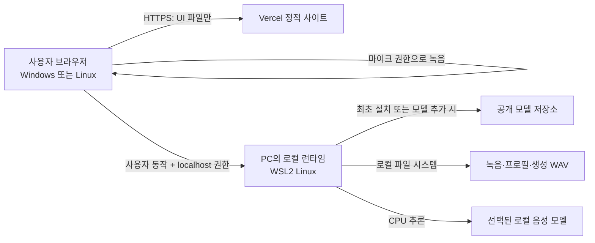

# 로컬 음성 녹음 스튜디오 — 제품·기술 설계

> 상태: 이 문서는 2026-11-03 WSL 기반 설계의 기록이다. Windows 사용자 설치 흐름은 [Windows 네이티브 설치기 설계](../superpowers/specs/2026-11-04-windows-native-installer-design.md)를 따른다. 아래 WSL 설치·메모리 지침은 Windows 사용자 설치에 적용하지 않는다.
> 작성일: 2026-11-03
> 기준 문서: [기존 로컬 음성 PoC PRD](./PRD_LOCAL_VOICE_BOOK_POC.md)
> 구현 계획: [단계별 구현 계획](../superpowers/plans/2026-11-03-local-voice-studio.md)

## 1. 제품 요약

Windows PC에서 마이크 녹음과 한국어 음성 생성을 수행하는 개인용 로컬 음성 스튜디오를 만든다. Vercel은 한국어 웹 인터페이스와 설치 가이드만 배포한다. 각 사용자는 자신의 PC에 로컬 런타임을 설치하고, 그 런타임이 모델 다운로드·녹음 보관·음성 합성을 담당한다.

기본 흐름은 다음과 같다.

브라우저만으로 운영체제 프로그램이나 모델을 설치할 수는 없다. 설치 페이지는 사용자가 검토 후 실행하는 설치 도구를 제공하고, 설치 도구가 별도 동의 아래 Python 환경·로컬 서비스·모델을 준비한다. 사이트는 Vercel Function, 데이터베이스, 파일 업로드, 계정, 결제, 원격 음성 추론을 사용하지 않는다.

## 2. 제품 목표와 성공 기준

### 목표

- 한국어 UI에서 녹음 장치를 고르고 입력 레벨을 확인하며, 낭독문을 보면서 여러 take를 녹음한다.
- 녹음 원본, 정확한 녹음 대본, 음성 프로필, 생성 결과를 사용자 PC에 보관한다.
- 로컬 서비스 상태와 모델 설치 상태를 확인하고, 여러 호환 모델 중 하나를 사용자가 골라 같은 문장으로 비교한다.
- Vercel UI는 가볍게 제공하고, 모델 가중치 및 오디오는 PC 밖으로 보내지 않는다.
- 새 사용자가 설치 안내를 따라 로컬 런타임을 시작한 뒤 첫 녹음과 짧은 합성을 완료할 수 있다.
- 저장한 엄마 목소리와 동화 대본, 장면 이미지를 묶어 자막과 음성이 함께 재생되는 동화 화면을 만든다.

### MVP 완료 판정

1. Vercel 정적 사이트가 설치 안내, 로컬 연결 상태, 녹음 스튜디오를 한국어로 표시한다.
2. 로컬 런타임이 `127.0.0.1`에서만 실행되고, 허용된 웹 출처와 페어링된 세션만 요청할 수 있다.
3. 사용자가 실제 마이크를 선택하고 권한을 승인한 뒤 녹음·일시정지·이어 녹음·중지·재생·삭제를 수행한다.
4. 음성 파일과 원문은 로컬 저장소에만 저장되고, 브라우저 새로고침 이후에도 보이스 프로필과 take가 유지된다.
5. 최소 두 모델을 같은 참조 음성 및 같은 문장으로 비교할 수 있다. 한국어 지원과 라이선스가 확인된 모델만 일반 제공 목록에 노출한다. CPU 미검증 모델은 실험 표시와 별도 확인을 요구한다.
6. 합성 파일을 재생하고 WAV로 내려받으며, 생성 시간·모델·텍스트·오류를 로컬에서 확인한다.
7. 실기기 브라우저 테스트에서 마이크 입력과 음성 재생을 확인한다. 자동화된 가짜 마이크만으로 실제 마이크 통과를 주장하지 않는다.
8. 기능 완료 후 Vercel Preview에서 UI와 localhost 연결 안내를 검증하고, Preview와 Production 배포 상태를 구별해 기록한다.

성공 기준에는 음성 유사도 점수 보장이 포함되지 않는다. 각 출력은 사용자가 직접 듣고 발음 정확성·목소리 유사도·자연스러움을 각각 평가한다.

## 3. 대상과 범위

### 첫 배포 대상

- 개발 및 통합 테스트: 사용자가 지정한 Linux 개발 환경 및 Linux 브라우저.
- 개인 실행 PC: Windows 10/11 64-bit + WSL2 Ubuntu. 기존 PC의 WSL 모델 설치를 재사용할 수 있도록 한다.
- 기본 추론: CPU. GPU가 없더라도 설치 흐름은 성공 여부를 감지하고, 지원되지 않는 경우를 명시한다.
- 언어: 인터페이스와 첫 품질 게이트는 한국어 중심.

초기 버전은 macOS, WSL 없는 Windows의 네이티브 Python, Linux 외부 배포판 설치를 보장하지 않는다. 이 지원이 필요해지면 운영체제별 설치 및 실기기 검증을 별도 단계로 추가한다.

### 포함

- 설치 전 사양/디스크/WSL 상태 안내, 로컬 런타임 연결 및 건강 상태.
- 장치 선택, 입력 레벨/클리핑 확인, 3초 카운트다운, 녹음/일시정지/재개/정지, 파형·타이머·재생·다시 녹음.
- 녹음 대본 작성 및 저장, 보이스 프로필과 여러 take 관리, take별 메모 및 품질 상태.
- 여러 로컬 모델의 설치/선택/리소스 안내/고정 문장 벤치마크.
- 한국어 음성 복제 합성, 진행 상태, 결과 재생/다운로드/삭제.
- 동화 대본을 장면별로 나누고 각 장면에 이미지와 생성 음성을 연결해, 이미지 위에 자막을 표시하며 재생.
- 로컬 로그, 저장 경로 안내, 녹음/프로필/결과 삭제.

### 제외

- 계정, 온라인 동기화, 사용자 음성 업로드 서버, 클라우드 모델 추론 또는 원격 API fallback.
- DAW 수준 편집, 믹싱, EQ, 자동 노이즈 제거, 트랙 레이어, 협업/공개 링크.
- 전자책 파싱 및 책 전체 일괄 합성. MVP의 단일 합성 요청은 짧은 문장/문단 중심이다.
- AI 이미지 자동 생성 및 완성 동화 영상 파일 내보내기. 첫 동화 화면은 사용자가 제공한 이미지를 장면에 연결한다.
- 등록된 여러 참고 녹음을 모델 입력 하나로 자동 합산한다고 약속하지 않는다. 사용자에게 현재 모델이 지원하는 참조 방식과 실제 선택된 take를 보여준다.
- 자동 감정 분석/연기 품질 보장. 모델별로 지시형 표현을 지원하는 경우에만 해당 모델의 기능으로 표시한다.

## 4. 사용자 흐름

1. 사용자는 Vercel 사이트에서 로컬 사용 방식, 최소 사양, 저장 위치, 개인정보 흐름을 확인한다.
2. 설치 확인 화면에서 WSL2·Python·디스크 공간·메모리를 점검한다. 부족한 항목을 구체적인 안내로 보여준다.
3. 사용자는 공개된 설치 스크립트를 내려받아 내용을 검토한 뒤 Windows PowerShell에서 실행한다. 스크립트는 WSL2 런타임을 만들고 선택한 모델을 공개 원본에서 내려받는다.
4. 런타임 시작 후 로컬 콘솔에 1회용 페어링 코드가 표시된다. 사용자는 웹 UI에서 명시적으로 연결을 시작하고 코드를 입력한다. 브라우저의 로컬 네트워크 접근 권한이 필요하면 그 이유를 화면에서 설명한다.
5. 녹음 스튜디오에서 프로필/세션과 낭독문을 준비하고 입력 장치·레벨을 확인한다. 실제 녹음 전에 짧은 테스트를 듣고 마이크 거리를 조정할 수 있다.
6. 동화 연습 대사를 고르거나 직접 입력해 읽고 take로 저장한다. 저장이 끝나면 방금 저장한 대본이 채워진 음성 생성 화면으로 바로 이동한다.
7. 사용자는 저장된 목소리를 선택하고 `저장된 텍스트로 음성 만들기`를 눌러 합성을 시작한다. 반복 녹음이 있으면 생성에 사용할 take 한 개를 선택한다.
8. 작업 상태를 확인하고 결과를 재생한다. 재생 결과와 생성 시간을 평가하고 WAV를 내려받거나 로컬 프로필에 보관한다.
9. 동화 만들기에서 대본을 장면별로 나누고, 각 장면의 그림과 읽을 문장을 연결해 음성을 생성한다.
10. 동화 플레이어에서 그림 위 자막을 보며 엄마 목소리로 재생한다. 이전/다음 장면과 재생/일시정지를 사용할 수 있다.
11. 설정 화면에서 모델 제거, 녹음/결과 삭제, 로컬 데이터 폴더 열기를 수행한다.

## 5. 화면 설계

### 5.1 앱 셸

- 상단: 제품명, 현재 로컬 연결 상태, 도움말/설정 진입.
- 왼쪽 탐색: `시작하기`, `녹음 스튜디오`, `내 음성`, `생성 결과`, `설정`.
- 콘텐츠는 사용 가능한 화면 너비를 채운다. 긴 문장은 적절한 줄 길이를 유지하고 작은 화면에서는 단일 열로 쌓는다.
- 상단 연결 배지는 `연결 안 됨`, `연결 확인 중`, `연결됨`, `모델 준비 필요`, `오류`로 구분한다. 색상만으로 상태를 전달하지 않는다.

### 5.2 시작/설치 화면

- 첫 화면에 제품의 로컬 처리 방식과 “녹음은 내 PC에 저장됩니다”를 명확히 표시한다.
- 단계 표시: `PC 확인 → 설치 → 모델 준비 → 로컬 연결 → 첫 녹음`.
- 사양 카드: 감지된 OS/WSL/RAM/CPU/디스크 여유, 모델별 권장/주의 상태.
- 설치 카드: WSL2가 없거나 런타임이 없을 때 대상 OS에 맞는 다운로드, 단계별 실행 및 문제 해결 설명.
- 연결 권한 도움말: Vercel HTTPS 페이지가 `localhost`에 접근할 때만 브라우저 권한을 요청하고, 음성 파일을 Vercel에 보내지 않는다는 점을 안내한다.
- 설치 진행을 브라우저에서 백그라운드로 실행하지 않는다. 모든 OS 변경과 모델 설치는 사용자가 다운로드한 프로그램을 명시적으로 실행하는 흐름이다.

### 5.3 녹음 스튜디오

- 기본 레이아웃: 왼쪽 녹음 작업 카드, 가운데 큰 녹음/파형 영역, 오른쪽 낭독문·녹음 팁. 작은 화면은 위에서 아래 순서로 접는다.
- 설정: 보이스 프로필, take 이름, 마이크 장치, 채널 설정. 실제 캡처 장치가 제공한 샘플레이트를 표시하고 브라우저에서 지원되지 않는 값을 성공한 것처럼 표시하지 않는다.
- 품질 관찰: 실시간 입력 레벨 미터, clipping 경고, 입력 없음 상태, 실제 녹음 시간.
- 조작: 3초 카운트다운, 녹음, 일시정지, 이어 녹음, 중지, 재생, 폐기, 저장.
- 파형: recording 중 진행 파형/시간. 유용한 상황 표시이며 실제 loudness·클리핑 판정은 오디오 샘플 기준으로 한다.
- 낭독 가이드: 짧은 문장, 정면 마이크 거리, 일정한 볼륨, 잡음/에코를 피하는 팁. 원문 텍스트는 녹음 후에도 수정할 수 있으나, 저장된 원문과 실제 발화가 다른 경우 확인 경고를 보여준다.
- 녹음 대본 선택지: 동화 연습 문장을 제공해 선택하면 저장할 대본 입력란을 채운다. 첫 버전은 사용자가 실제로 읽은 문장을 확인해 저장하며 자동 음성 인식은 포함하지 않는다.
- 여러 take: 같은 대사나 다른 연습 대사로 반복 녹음할 수 있고 각 파일을 별도 take로 보관한다. 음성 생성 요청은 현재 선택한 한 개 take만 참조하므로 take 간 품질을 직접 비교한다. 모델이 여러 take를 자동 합산해 보이스를 학습한다고 안내하지 않는다.
- 기본 가이드 길이 10–30초, take 최대 길이는 설정값으로 제한하며 초과 전에 경고한다. 상한은 실제 브라우저/로컬 전송 테스트 후 확정한다.

### 5.4 내 음성

- 프로필 카드에는 이름, 생성/수정일, 보관 take 개수, 기본 take, 최근 품질 메모를 표시한다.
- 프로필 안에서 take별 재생, 대본 확인, 교체/삭제, 기본 참조 지정.
- 한 생성 요청에 사용되는 reference는 모델 어댑터가 지원하는 범위로 명시한다. MVP 기본은 “선택한 한 개 take”로 안내한다.
- 사용자가 프로필을 삭제하면 해당 프로필의 원본 녹음과 대본을 함께 지운다는 확인을 받는다.

### 5.5 음성 생성 및 비교

- 입력: 낭독 문장, 활성 보이스 프로필, 해당 프로필의 참조 take, 모델 선택.
- 모델 선택 카드: 이름/버전/라이선스, 한국어 복제 지원, 설치 크기, 설치/CPU 검증 상태, 참고 RAM과 예상 속도 범주. 측정값이 없으면 추정치 대신 `아직 측정 안 됨` 표시.
- `모델 비교`는 같은 입력을 사용해 선택된 모델들을 순차 실행한다. 메모리 부족 PC에서 동시에 모델을 적재하거나 동시에 생성하지 않는다.
- 결과 패널: 상태·모델·텍스트·생성 시간·오디오 길이·실행 환경을 표시하고, 재생·WAV 내려받기·삭제를 제공한다.
- 결과 평가: 발음 정확성, 목소리 유사도, 자연스러움 각 1–5점 및 선택 메모. 자동 점수로 음질을 보증하지 않는다.

### 5.6 동화 장면 편집 및 플레이어 (최종 목표)

- 편집 흐름: 동화 대본을 장면 단위로 나누고, 각 장면에 이야기 문장, 저장한 엄마 보이스, 장면 이미지, 생성 오디오를 연결한다. 장면 순서는 바꿀 수 있다.
- 첫 버전에는 백설공주, 아기 돼지 삼형제, 빨간 모자 샘플 동화와 부드러운 파스텔 톤의 자체 생성 삽화 9장을 미리 제공한다. 삽화는 아이와 보호자가 함께 읽기 좋은 둥글고 친근한 일본식 카와이 그림책 분위기로 구성하며, 기존 작품 캐릭터나 로고를 복제하지 않는다. 개인 이미지 추가는 후속 범위다.
- 플레이어는 큰 그림을 중심으로 전체 화면 너비를 사용한다. 현재 읽는 자막을 그림 위 하단에 반투명 배경으로 표시하고, 재생/일시정지·이전/다음 장면·진행 시간을 제공한다.
- 장면 오디오가 끝나면 다음 장면의 그림과 자막으로 넘어간다. 사용자가 특정 장면을 선택하면 그 문장부터 재생한다.
- 작은 화면에서는 그림 비율을 보존하고 자막을 이미지 아래로 옮겨 글자를 읽을 수 있게 한다. 키보드 조작과 자막 표시/숨김을 지원한다.
- MVP는 장면별 이미지·대본·오디오 재생 화면까지 포함한다. 이미지 자동 생성과 MP4 내보내기는 후속 기능으로 두고 별도 로컬 처리/리소스 검증을 거친다.

#### 첫 동화 시나리오 템플릿

첫 화면에서는 세 작품 중 하나를 고르고, 각 작품은 3장면 이미지와 20줄 미만의 짧은 낭독 대본으로 시작한다. 아래 대본은 새로 쓴 짧은 재구성 문장이다. 실제 샘플 이미지 파일과 생성 안내는 `web/public/storybook/SOURCES.md`에 정리한다.

| 동화 | 장면 이미지 1–3 | 엄마가 읽을 짧은 대본 |
|---|---|---|
| 백설공주 | 1. 숲속 오두막을 발견한 백설공주 2. 사과를 건네는 할머니로 변장한 왕비 3. 친구들과 다시 만난 백설공주 | 1. 백설공주는 깊은 숲을 헤매다 작은 오두막을 찾았어요. 2. 오두막에서 일곱 친구를 만나 따뜻한 잠자리를 얻었지요. 3. 어느 날 낯선 할머니가 반짝이는 사과를 내밀었어요. 4. 사과를 한입 베어 문 백설공주는 깊은 잠에 빠졌어요. 5. 친구들이 슬퍼할 때, 진심 어린 도움으로 백설공주가 눈을 떴어요. 6. 백설공주는 친구들과 오래오래 행복하게 지냈답니다. |
| 아기 돼지 삼형제 | 1. 각자 집을 짓기 시작한 세 형제 2. 늑대가 짚집과 나무집을 찾아온 장면 3. 벽돌집 안에서 안도하는 형제들 | 1. 아기 돼지 삼형제는 각자 살 집을 짓기로 했어요. 2. 첫째는 짚으로, 둘째는 나무로, 셋째는 튼튼한 벽돌로 지었지요. 3. 어느 날 배고픈 늑대가 짚집 앞에 나타났어요. 4. 늑대가 후 하고 불자 짚집은 바람에 날아갔어요. 5. 형제들은 단단한 벽돌집으로 달려가 문을 꼭 닫았어요. 6. 셋은 힘을 모으면 어려움도 이길 수 있다는 걸 배웠답니다. |
| 빨간 모자 | 1. 바구니를 들고 숲길을 걷는 빨간 모자 2. 할머니 집에서 할머니로 꾸민 늑대를 만난 장면 3. 할머니와 빨간 모자가 함께 웃는 장면 | 1. 빨간 모자는 아픈 할머니께 드릴 바구니를 들고 숲길을 걸었어요. 2. 길에서 만난 늑대는 할머니 집이 어디인지 물었어요. 3. 빨간 모자는 꽃을 구경하다가 할머니 집에 늦게 도착했어요. 4. 침대에는 할머니 옷을 입은 늑대가 누워 있었어요. 5. 이웃의 도움으로 할머니와 빨간 모자는 무사히 만났어요. 6. 빨간 모자는 다음부터 약속한 길로 다니기로 했답니다. |

### 5.7 설정/진단

- 로컬 런타임 버전, 연결 상태, 서비스 포트, 데이터 경로, 모델 목록, 최근 오류를 확인한다.
- CPU/RAM/WSL 메모리 한도와 현재 여유를 표시한다. 물리 RAM과 WSL이 사용할 수 있는 한도를 구분한다.
- 모델 다운로드/제거와 캐시 크기 확인, 저장소 열기, 로그/음성 데이터 삭제를 제공한다.
- 진단 로그 내보내기는 사용자가 명시적으로 실행한다. 로그에 음성 데이터, 녹음 대본, Authorization token, 음성 내용을 넣지 않는다.

## 6. 기술 구조 및 인터페이스

### 웹 프런트엔드

- React + TypeScript + Vite 기반 정적 빌드, Vercel CDN 배포.
- `@windsoft/ui`와 `@windsoft/ui/global.css`를 사용한다. 디자인 토큰과 접근 가능한 공통 컨트롤은 패키지를 우선하고, 오디오 전용 파형/레벨 미터/전송 상태는 앱 컴포넌트로 구현한다.
- 프런트엔드에서 Vercel API route나 서버 데이터 저장을 만들지 않는다.
- HTTPS에서 `getUserMedia` 권한을 요청한다. 권한은 사용자가 `마이크 확인`/`녹음 시작`을 눌렀을 때에만 요청한다.
- Chrome Local Network Access를 지원하도록 loopback fetch의 사용자 권한, `targetAddressSpace: 'loopback'`, CORS 및 실패 안내를 구현한다. 개발 환경과 Production에서 허용 Origin을 각각 명시한다.

### 로컬 런타임

- WSL2 Python 3.12 환경에서 실행하는 FastAPI 기반 localhost API와 로컬 worker.
- 모델은 하나씩 로드/언로드할 수 있다. 요청을 비동기 job으로 등록하고 프런트엔드는 상태를 확인한다.
- 모든 HTTP listener는 `127.0.0.1`에만 바인딩한다. LAN 주소, `0.0.0.0`, 공개 터널, 공유 링크는 금지한다.
- 프로세스는 브라우저와 분리되어 계속 실행된다. 사용자가 연결을 끊거나 웹 페이지를 닫아도 진행 중 작업 상태를 로컬에 보존하고 재접속 시 조회할 수 있다.
- 파일 시스템과 모델 레지스트리만 사용한다. 계정/클라우드 DB 없이 음성 프로필과 job metadata를 JSON manifest로 저장한다. 파일 갱신은 임시 파일 후 atomic rename한다.

### 초기 API 계약

모든 경로는 `http://127.0.0.1:<port>/api/v1`이며, 민감한 요청은 로컬 페어링 토큰을 요구한다.

| API | 역할 | 제한 |
|---|---|---|
| `GET /health` | 서비스/버전/지원 API 상태 | 민감한 경로·토큰 제외 |
| `POST /pair` | 명시적 사용자 동작으로 1회용 코드 교환 | 코드 단기 만료, rate limit, 토큰 반환 |
| `GET /system` | OS/WSL/CPU/RAM/디스크 및 모델 적합성 확인 | 사용자 클릭 뒤 실행 |
| `GET /models` | 모델 설치·지원·라이선스·리소스 메타데이터 | 모델이름 allowlist |
| `POST /models/{id}/install` | 확인된 모델 다운로드/설치 job | 라이선스 고지 및 용량 확인 |
| `POST /recordings` | WAV와 대본/프로필 메타데이터 로컬 저장 | 길이/크기/샘플레이트/코덱 검사 |
| `GET /profiles` 및 관련 상세 경로 | 로컬 프로필/take 목록 조회 | 경로 traversal 방지 |
| `POST /generations` | 짧은 텍스트, 모델 ID, take ID로 합성 job 시작 | 텍스트·길이 제한, 모델 단일 적재 |
| `GET /jobs/{id}` | 설치/합성 진행과 결과 상태 확인 | job 소유/세션 권한 검사 |
| `GET /outputs/{id}` / `DELETE` | 로컬 재생 파일 조회/삭제 | 경로 allowlist, 권한 확인 |

API 요청/응답 schema는 OpenAPI에서 생성하고 TypeScript 클라이언트를 빌드 시 생성하거나 검증한다. 경로/필드명과 실제 함수 타입은 API 구현 phase에서 단일 계약으로 고정한다.

## 7. 데이터 및 개인정보

- 녹음 시작 때 브라우저가 사용자 마이크에서 오디오를 캡처한다. 저장 시 브라우저는 파일을 loopback API로만 보낸다.
- Vercel에는 정적 프런트엔드 파일/설치 스크립트만 배포한다. 사용자 텍스트/음성/생성 WAV는 Vercel, 외부 분석 SDK, 원격 로그로 전송하지 않는다.
- 원본 take, 참조 대본, 정규화 reference, 생성 결과를 로컬 runtime의 사용자 데이터 디렉터리 아래 분리한다. 정규화 파일은 원본을 덮어쓰지 않는다.
- 기본 녹음 보존은 삭제 시까지, 명시된 저장 용량 경고와 사용자 삭제를 제공한다. 로그는 7일 또는 제한 크기로 순환하고 사용자 데이터와 분리한다.
- Vercel 정적 배포에서 개인 음성에 대한 인증·저장을 제공하지 않으므로 웹 분석/세션 추적을 추가하지 않는다.

## 8. 로컬 서비스 보안

- 네트워크: IPv4 loopback만 허용, DNS rebinding 대응 Host 검사, exact Origin allowlist, HTTPS Vercel 페이지의 Chrome Local Network Access 권한 요구.
- 페어링: 로컬 프로세스가 짧은 만료 코드와 강한 무작위 세션 토큰을 생성한다. 토큰은 브라우저 메모리 또는 탭 세션에만 보관하고 localStorage/cookie에 장기 저장하지 않는다. 서버 재시작 시 페어링을 폐기한다.
- 변경 요청은 Authorization header와 CSRF 방어용 사용자 정의 헤더를 요구한다. 브라우저의 자동 페이지 로드에서 다운로드/녹음/생성을 시작하지 않는다.
- 파일 경로는 내부 ID로 선택하며 사용자가 보낸 파일명/경로를 저장 경로로 직접 사용하지 않는다. 업로드 타입은 확장자와 실제 WAV 헤더를 함께 검사한다.
- 설치 스크립트는 사람이 읽을 수 있게 제공하고, 관리자 권한을 조용히 요청하지 않으며, 파일 삭제나 WSL 리셋 같은 파괴 작업을 하지 않는다.
- 다운로드 모델은 공개 원본/버전을 고정하고 라이선스·해시 확인을 기록한다. 체크포인트와 본인 음성을 저장소/프런트 번들에 넣지 않는다.

## 9. 모델/성능 정책

### 1차 모델 목록

| 모델 | 역할 | UI 상태 | 비고 |
|---|---|---|---|
| Qwen3-TTS 12Hz 0.6B Base | 기준 한국어 음성 복제 | `기준 모델` | 기존 PoC에서 설치/CPU 모델 로드 및 UI 확인. 실기기 마이크·음질 게이트는 아직 별도 검증 필요. |
| Fun-CosyVoice3 0.5B | 한국어 zero-shot 복제 및 지시형 스타일 비교 후보 | `실험 모델` | 한국어/복제 기능은 공식 저장소에 명시. 공식 설치 문서의 CPU 성능 보장은 확인되지 않았으므로 별도 venv에서 호환성·속도를 검증한 뒤 제공. |
| Qwen3-TTS 12Hz 1.7B Base | 품질·자원 비교 후보 | `사양 확인 후` | 16GB Windows/WSL 기본 한도에서 무리하게 자동 설치하지 않는다. 여유 RAM·디스크 및 CPU 측정 뒤 opt-in 제공. |

모델이 한국어를 표시한다고 한국어 발음/음성 복제 품질이 보장되는 것은 아니다. 라이선스와 실행 경로를 확인하지 못한 모델은 다운로드 버튼을 활성화하지 않는다. 자동 모델 교체는 하지 않으며, 사용자가 모델을 선택한다.

### 프로파일과 벤치마크

- `빠른 테스트`, `균형`, `큰 모델 실험`은 감지 CPU/RAM/WSL 한도·현재 여유·디스크·기존 모델 적재량 및 실제 생성 기록을 참고해 추천한다. CPU 코어 수 하나만으로 성능을 단정하지 않는다.
- 1차 벤치마크 문장과 참조 take를 고정해 모델별 결과를 차례로 생성한다. 첫 설치/모델 로딩 시간과 warm generation을 분리 기록한다.
- 기록값: 모델 ID/revision, 실행 환경/CPU/RAM, 모델 load sec, 생성 sec, 출력 audio sec, RTF(생성 sec ÷ 출력 sec), 최대 RSS, exit/error, 결과 파일 ID.
- RTF가 1보다 크면 실시간보다 느리다는 것을 표시한다. 점수나 예상 시간은 사용자 PC 실측 전 보장하지 않는다.
- 청취 점수는 발음 정확성/음색 유사도/자연스러움 각 1–5, 사용자 평가와 모델·입력의 연결을 로컬 manifest에 기록한다.
- CPU threading, WSL 메모리 한도, 동시 앱 영향은 모델 비교와 별도 설정으로 한 번에 한 변수씩 실험한다.

## 10. WindSoft 디자인 적용

WindSoft Design System 운영 MCP endpoint에 HTTP MCP `initialize`, `tools/list`, `tools/call`을 실제 요청해 연결과 도구 사용을 확인했다. MCP는 사용자용 production web page에서 호출하지 않고 개발 단계에서 디자인 자산을 조회하는 데만 쓴다.

조회 기준:

- MCP 안내: `https://windsoft-design-system.vercel.app/?path=/docs/docs-mcp-guide--docs`
- 운영 endpoint: `https://windsoft-design-system.vercel.app/api/mcp`
- 사용 가이드에 따라 `@windsoft/ui` 및 `@windsoft/ui/global.css`를 기본 적용한다. 최신 설치 시 peer dependency와 호환 버전을 설치하고 정확한 버전은 implementation phase에서 고정한다.
- `Button`, `Card`, `FormField`, `Input`, `Textarea`, `Select`, `FileUpload`, `StatusBadge`, `Tabs`, `Stepper`를 우선 검토한다. `AudioPlayer`, 전문 waveform, input level meter는 MCP에서 컴포넌트를 찾지 못했으므로 도메인 컴포넌트로 구현한다.
- Light semantic token을 조회했다. `--color-brand`, `--color-surface`, `--color-background`, `--color-foreground`, `--color-border`, `--color-success`, `--color-warning`, `--color-danger`, `--spacing-*`를 직접 참조한다. 컴포넌트에 임의 브랜드 색을 하드코딩하지 않는다.
- 녹음 빨강은 `recording`이라는 상태 의미에만 사용한다. 상태 아이콘/텍스트를 같이 표시하고 색상만으로 레코딩/클리핑/오류를 구분하지 않는다.

## 11. 비기능 요구 및 관측

- 웹 빌드에 모델 가중치/모델 런타임을 포함하지 않는다. 설치 전 첫 화면이 빠르게 뜨도록 정적 파일 중심으로 유지한다.
- 로컬 API 요청은 지연/파일 크기/작업 ID만 안전하게 화면에 노출한다. 음성 payload와 참조 문장 로그는 금지한다.
- 긴 모델 설치/추론은 HTTP 요청을 길게 붙잡지 않고 job 상태를 폴링한다. 재시도는 설치 단계와 생성 단계에 각각 명시한다.
- 실패 상태에는 다음 행동을 표시: WSL 서비스 시작, 브라우저 권한 허용, 페어링 재시도, 디스크 공간 확보, 설치 로그 열기.
- 접근성: 키보드로 모든 녹음 조작 가능, 포커스 표시, 레벨 미터의 텍스트 상태, 녹음 중 screen reader 상태 알림, 명확한 시간 표시.
- 모델 리소스 감지 정보와 실제 load 결과가 다르면 모델을 계속 시도하지 말고 로그/메모리 원인을 보여준다.

## 12. 주요 위험과 대응

| 위험 | 대응 |
|---|---|
| Chrome이 Vercel에서 localhost 연결 권한을 차단/거부 | HTTPS, LNA loopback permission, exact CORS, 사용자 동작으로 첫 연결, 권한 문제 해결 화면. 로컬 UI 모드로 돌아갈 수 있게 구성 |
| 16GB PC에서 WSL 기본 메모리 제한/스왑으로 추론 지연 또는 OOM | Windows/WSL 메모리를 분리해 표시, 짧은 입력/하나씩 모델 적재, WSL 메모리 설정 가이드, 모델별 실측 적합성 |
| 두 모델 간 라이브러리 버전 충돌 | 각 모델 어댑터/venv를 분리하고 공용 API schema만 유지. 사용자 환경에서 의존성을 덮어쓰지 않음 |
| 마이크 지원/실제 샘플레이트 차이 | `getUserMedia`와 `MediaStreamTrack.getSettings()` 결과를 표시하고 권한/장치 예외 처리. 실제 장치 수동 테스트 통과 전 합격 선언 금지 |
| 공개 Vercel 페이지가 개인 음성 처리 주체로 오인 | 연결 전에 데이터 흐름과 localhost 전송을 설명하고, 로컬 저장/전송 경로를 상태 화면에서 확인 가능하게 함 |
| 모델 라이선스/음성 복제 사용권 문제 | 설치 전에 라이선스와 다운로드 출처 표시, 본인 또는 허가된 음성만 사용 안내 |

## 13. 기준 정보와 레퍼런스

- 현 저장소의 [PoC PRD](./PRD_LOCAL_VOICE_BOOK_POC.md), [실행 기록](../../RUN_LOG.md), 기존 Linux 설치/시작 스크립트.
- [WindSoft MCP Guide](https://windsoft-design-system.vercel.app/?path=/docs/docs-mcp-guide--docs), [WindSoft MCP endpoint](https://windsoft-design-system.vercel.app/api/mcp).
- [Chrome Local Network Access 안내](https://developer.chrome.com/docs/modern-web-guidance/guides/security/local-network-access).
- [브라우저 마이크 API](https://developer.mozilla.org/en-US/docs/Web/API/MediaDevices/getUserMedia).
- [Microsoft WSL 설정](https://learn.microsoft.com/windows/wsl/wsl-config).
- [Vercel Functions](https://vercel.com/docs/functions). 본 제품 아키텍처에서는 음성/모델 서버로 사용하지 않는다.
- [Qwen3-TTS](https://github.com/QwenLM/Qwen3-TTS), [Qwen3-TTS 0.6B Base](https://huggingface.co/Qwen/Qwen3-TTS-12Hz-0.6B-Base).
- [CosyVoice 공식 저장소](https://github.com/FunAudioLLM/CosyVoice).

## 14. 기존 PoC PRD와의 관계

기존 PRD의 공식 Gradio UI 우선, 맞춤 UI 제외, REST API 제외, 한 모델만 사용, Vercel 미사용 조건은 이번 사용자 요청으로 변경되었다. 기존 설치/모델 검증 기록은 기준 모델과 로컬 CPU 성능의 출발점으로 보존한다. 이후 개발은 이 설계 문서와 단계별 계획을 따른다. 사용자는 설계 문서 작성 후 단계별 구현을 요청했으며, 현재 계획에 따라 구현을 진행한다.
